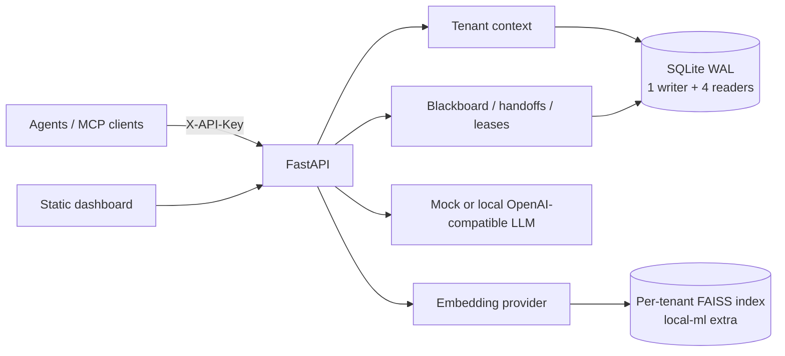
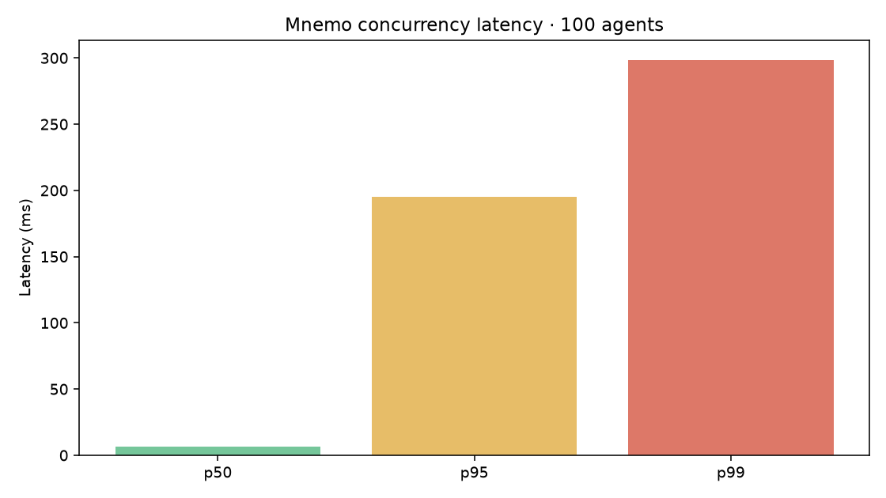
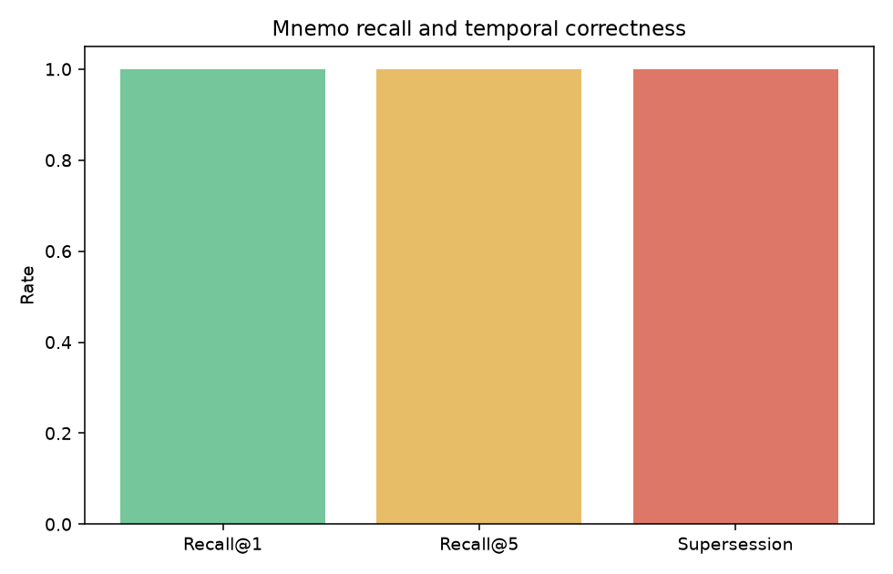

# Mnemo

Mnemo is a local-first memory and coordination layer for AI agents. It gives multiple agents durable episodic, semantic, and procedural memory, a tenant-scoped shared blackboard, leases, and explicit handoffs, so a later session can continue from the facts and work already captured. It runs on FastAPI and SQLite without a paid service; local sentence-transformer embeddings and an OpenAI-compatible local LLM are supported, with deterministic fake embeddings and a rule-based mock LLM for offline development.

## Architecture



## Track Coverage

| Track requirement | Mnemo implementation |
|---|---|
| Episodic memory | Tenant-scoped episodes, filters, weighted semantic/recency/importance search, archive instead of hard-delete. |
| Semantic memory | Facts with confidence, source episode, validity intervals, supersession history, point-in-time reads, and extraction. |
| Procedural memory | Versioned create/edit/archive, embedding-ranked matching, and success/failure counters. |
| Persistent conversation history | Conversation/session records, message append, latest rolling summary, context-window endpoint, SQLite persistence. |
| Shared state and handoffs | Versioned compare-and-swap blackboard, live SSE, handoff inbox and lifecycle, renewable expiring leases. |
| High concurrency | SQLite WAL, a serialized writer connection, four independent read connections, and bounded per-tenant database operations. |
| Tenant isolation | Hashed API keys resolve the tenant on the server; data and vector lookups filter by that tenant; foreign IDs return 404. |

## Setup

Requires `uv` and Python 3.11 or newer. The default `.env.example` selects fake embeddings and the mock LLM, so no model download or network API is required.

```sh
uv sync --extra dev
cp .env.example .env
uv run uvicorn mnemo.main:app --reload
```

Create a tenant using the admin key from `.env`; the response contains its one-time API key. Enter that key in the dashboard at `http://127.0.0.1:8000/dashboard`.

```sh
curl -s -X POST http://127.0.0.1:8000/admin/tenants \
	-H 'X-Admin-Key: local-admin-change-me' \
	-H 'Content-Type: application/json' \
	-d '{"name":"Acme","agent_id":"triage"}'
```

For local sentence-transformer embeddings and persisted FAISS indexes, install `uv sync --extra dev --extra local-ml` and set `EMBEDDER=sentence-transformers` in `.env`. The first embedding call downloads `all-MiniLM-L6-v2`. `EMBEDDER=lm-studio` uses the OpenAI-compatible `/embeddings` endpoint at `LLM_BASE_URL`.

Set a non-default `MNEMO_ADMIN_KEY` before exposing the service beyond localhost. Tenant API keys are generated once and only SHA-256 hashes are stored.

## Run It

Run the complete scripted two-tenant scenario:

```sh
uv run python -m agents.demo
```

The equivalent launchers are `scripts/run_demo.sh` and `scripts/run_demo.ps1`. To provision a tenant against a running service using the configured admin key, run `uv run python scripts/seed.py`.

It stores Alice's plan and contact preference, hands the billing issue to Billing, persists a resolution procedure, closes and reopens the app lifespan, recalls the facts in a new session, supersedes the plan while retaining its prior value, demonstrates a CAS conflict and SDK retry, checks cross-tenant denial, and runs consolidation. The demo sets `EMBEDDER=fake` and `LLM=mock` by default when those variables are unset.

Run the test suite:

```sh
EMBEDDER=fake LLM=mock uv run --extra dev pytest
```

The dashboard is served at `/dashboard`. Its graph uses Cytoscape.js from cdnjs when online and degrades to an explanatory empty view when the library cannot load. Blackboard updates use an authenticated fetch-based SSE stream.

The MCP stdio server exposes `remember_episode`, `remember_fact`, `recall`, `search_memory`, `blackboard_get`, `blackboard_set`, `create_handoff`, and `check_inbox`. Start the FastAPI service, set `MNEMO_API_KEY` and optionally `MNEMO_URL`, then run:

```sh
uv run python -m mnemo.mcp_server
```

VS Code users can start it through `.vscode/mcp.json`; the tenant key is prompted and not saved in the file. The implementation uses the [official MCP Python SDK](https://github.com/modelcontextprotocol/python-sdk).

## Benchmarks

Generated benchmark artifacts live in [`benchmarks/results`](benchmarks/results). The full concurrency run used 100 in-process agents, five tenants, and 60 seconds; recall used 200 facts over 50 simulated sessions and fake embeddings.

| Benchmark | Measured result |
|---|---|
| Concurrency | 85,961 requests / 61.27 s = **1,403.06 req/s**; p50 **6.74 ms**, p95 **195.17 ms**, p99 **298.48 ms**; error rate **0.00000**. |
| CAS contention | 35,066 conflicts retried; **100%** retry success; final counters matched all **2,080** successful increments. |
| Tenant isolation under load | **0** cross-tenant leaks; **0** lost updates. |
| Recall | recall@1 **1.00**, recall@5 **1.00** across four session-1 questions; supersession **1/1** correct. |
| Adversarial isolation | **14/14** checks passed, including foreign read/update/delete and semantic search. |





Re-run them with:

```sh
EMBEDDER=fake LLM=mock uv run python -m benchmarks.concurrency
EMBEDDER=fake LLM=mock uv run python -m benchmarks.recall
EMBEDDER=fake LLM=mock uv run python -m benchmarks.isolation
```

The concurrency figures are for a single local process and in-process ASGI transport, not a multi-host deployment. The fake embedder makes recall deterministic and fast; it is not a measure of natural-language embedding quality. Tail latency rises under simultaneous SQLite writes and CAS retries.

## Design Decisions

- **SQLite WAL:** one local durable file, no separate database service, concurrent readers, and crash-safe commits. A single write lock serializes writes; four reader connections serve reads independently. This is deliberately a single-process design.
- **Compare-and-swap:** blackboard updates require the version the caller read. A conflict returns the current version/value, and the SDK retries with jitter, preventing silent lost updates.
- **Supersession instead of delete:** replacing a fact closes its validity interval and links the replacement. Point-in-time queries and audit history remain possible.
- **Per-tenant vectors:** FAISS files and their ID maps live below `data/tenants/<tenant_id>/`; rebuilding a missing tenant index reads only that tenant's SQLite rows. Without the optional FAISS extra, the same tenant-partitioned vectors use a NumPy cosine/dot-product fallback.
- **Local model adapters:** fake embeddings and MockLLM keep tests and the demo network-free. Sentence Transformers and an OpenAI-compatible LM Studio endpoint are opt-in providers, not required for basic development.
- **Budgeting:** recall keeps whole records in priority order where possible, with a character-based approximation of four characters per token.

## Limitations

- One Mnemo process owns the SQLite writer and in-memory SSE subscriber registry; horizontal multi-process deployment needs a shared event bus and a database designed for multiple writers.
- The local fake embedder is deterministic hashing, not semantic-quality retrieval. FAISS is installed with the `local-ml` extra; without it search uses the NumPy fallback.
- The mock LLM uses small rules and produces generic summaries. Production-quality extraction and summarization need a configured local model endpoint.
- Consolidation uses heuristics for repeated resolved event types and normalized duplicate facts. It is a useful local maintenance pass, not a learned policy optimizer.
- The dashboard and default admin key are intended for localhost development. Configure a strong admin key and place a trusted authenticated proxy in front of any shared deployment.
- Metrics are in-memory aggregates. Request ID headers are returned, but logs and metrics are not persisted or exported to an observability backend.

## Future Work

- Add multi-process coordination and durable SSE replay with a broker.
- Add stronger role-based authorization, key rotation/revocation, and audit coverage for every mutation.
- Evaluate recall with a larger human-authored query set and local sentence-transformer embeddings.
- Add schema migration versions and backpressure controls for sustained write-heavy production traffic.